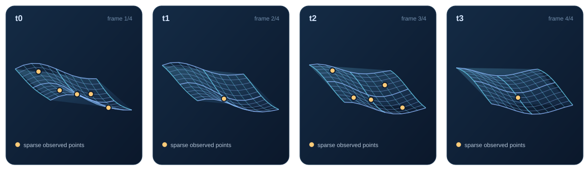
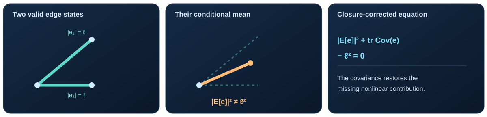
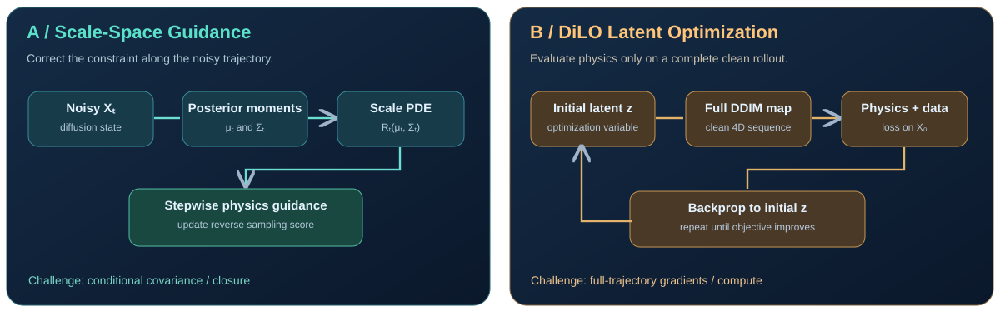

# Where Should Physics Enter Diffusion?

> **Group Meeting Outline · 4D Cloth Reconstruction**  
> Concept sketch — **not** experimental results.

## 1. Task: 4D Reconstruction

Sparse tracked 3D points → a complete time-varying cloth surface \(X_0=\{V^1,\dots,V^T\}\).

## 2. Concrete Physics: Nearly Inextensible Cloth

For mesh edge \((i,j)\), encourage its rest length \(\ell_{ij}\) across time:

\[
R_{ij}(X)=\|v_i-v_j\|^2-\ell_{ij}^2\approx0.
\]

*This is a stretching constraint, not a complete cloth dynamics PDE.*

## 3. The Core Issue: Jensen Gap

For edge displacement \(e=v_i-v_j\), even valid individual states need not yield a valid posterior mean:

\[
\mathbb E[\|e\|^2\mid X_t]=\|\mathbb E[e\mid X_t]\|^2+\mathrm{tr}\,\mathrm{Cov}(e\mid X_t).
\]

## 4. Two Physics-Injection Routes

| | **A. Scale-Space / Closure** | **B. DiLO-Inspired Optimization** |
|---|---|---|
| **Where** | Every noisy denoising step | Only complete clean output |
| **Mechanism** | Corrected residual: \(R_t=\|\mu_e\|^2+\mathrm{tr}\Sigma_e-\ell^2\) | Optimize initial latent \(z\), where \(X_0=F_\theta(z)\) |
| **Benefit** | Noise-consistent physics signal | Avoids evaluating physics on intermediate noisy states |
| **Challenge** | Conditional covariance estimation | Full trajectory backpropagation, runtime |

For Route B, one candidate objective is:

\[
\min_z \underbrace{\|A(F_\theta(z))-y\|^2}_{\mathrm{observations}}+\lambda\underbrace{\sum_{t,(i,j)}R_{ij}(F_\theta(z)^t)^2}_{\mathrm{edge\ constraints}}.
\]

## 5. Minimal Experiment

**Same prior, same partial observations:** compare (i) uncorrected clean-prediction guidance, (ii) covariance-corrected guidance, (iii) DiLO-style clean-rollout optimization.

**Metrics:** observation error · edge strain · temporal consistency · runtime.

**Discussion:** Could inexpensive closure guidance provide an initialization for DiLO?

---

**References:** [DiLO (Liu & Lin, 2026)](https://arxiv.org/abs/2604.11375) · *Scale-Space PDE Guidance for Diffusion Models: Feasibility* (Oct 20, 2026 internal note).

**[Open the illustrated meeting page](./index.html)**
